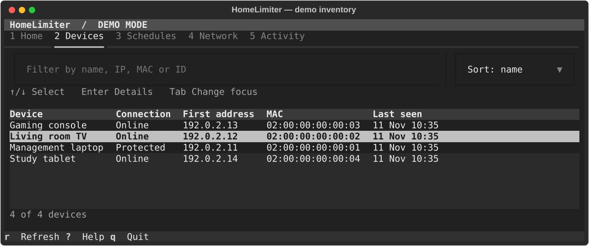

# HomeLimiter

HomeLimiter is a terminal tool for viewing devices and managing bandwidth and access on
networks you administer. It works with any router brand. Actual restrictions require an
authorized Linux gateway in the traffic path.

## Features

- Search and sort a passive device inventory; save nicknames, confirm identities and protect infrastructure.
- Set separate upload/download caps, use speed presets, or pause access temporarily.
- Create and edit bedtime, recurring and one-time rules. Review the next window change.
- Check gateway availability, acknowledged rules, recovery events and audit history.
- Practice in an isolated demo, or keep schedules running with the optional headless controller.

## Terminal preview



Captured from the running Textual app with the simulated inventory.

## Quick start: Windows

Install Git and Python 3.12 or later. In PowerShell:

```powershell
git clone git@github.com:0xAldoLim/HomeLimiter.git
cd HomeLimiter
.\run.ps1
```

Run `.\run.ps1 --demo` to practice. See [Windows setup](docs/WINDOWS_SETUP.md) if
PowerShell blocks the script.

## Quick start: Linux or Kali

Install Git, Python 3.12 or later, and its venv support (e.g. `python3-venv` on Kali):

```bash
git clone git@github.com:0xAldoLim/HomeLimiter.git
cd HomeLimiter
./run.sh
```

Run `./run.sh --demo` for the demo. If you haven't configured GitHub SSH, use
`git clone https://github.com/0xAldoLim/HomeLimiter.git` on either OS.

The first run installs dependencies in the checkout's `.venv`. It needs package download
access. Later runs reuse it. The launchers do not install services or change network settings.

## Basic usage

The first launch guides you through checking the environment, choosing a mode, selecting
an authorized scope, and reviewing cached device identities. Rerun it under **4 Network →
Setup wizard**. For the demo, the protected management laptop is intentionally ineligible
for restrictions.

- **1–5** switches sections. **Tab** moves focus; **↑/↓** and **Enter** select a device or rule.
- In **Devices**, open a row and choose **Identity**, **Limit**, **Pause**, or **Schedule**.
  Review the exact target before saving. Choose **Saved policies** to remove a single
  restriction, or **Restore all** to remove that device's rules and future schedules.
- In **Schedules**, use **Enter** to edit or remove a rule. Window timing and enforcement
  status are separate. **R** refreshes and **Q** exits.

The installed `homelimiter` command opens the TUI. The same commands work through the
launcher. For example:

```sh
homelimiter doctor
homelimiter --demo devices
homelimiter --demo limit demo-2 --download 5 --upload 2 --dry-run
homelimiter --demo schedules
homelimiter --demo logs
```

For unattended schedules, start `homelimiter serve` in a separate terminal and leave it
running. Open the TUI with `homelimiter --connect 8787` using the same profile. See
[headless operation and recovery](docs/INSTALLATION.md#keep-schedules-running).

## Supported modes

| Mode | What it can do |
|---|---|
| Monitor only | Read cached neighbors in explicitly authorized networks on Windows or Linux. |
| Demo | Simulate four devices and policy effects in separate local state. |
| Managed routed Linux gateway | Apply IPv4/IPv6 limits and access pauses through an authorized agent. Experimental, reported as **Partial control**. |
| Managed bridge | Passive monitoring only. Inline bridge enforcement is unavailable. |

## Limits

An ordinary Windows laptop, VMware NAT guest or bridged VM cannot throttle unrelated LAN
traffic. A device may use addresses or paths the agent cannot see. Installed rules do not
certify end-to-end traffic coverage. Live throughput counters and router provisioning
are unavailable. See [supported capabilities](docs/SUPPORTED_CAPABILITIES.md).

## Architecture

Textual and Typer share the controller's inventory, SQLite state and policy services.
A separate runtime reconciles policies and renews the agent lease. The Linux agent owns
its nftables and traffic control resources. [Architecture](docs/ARCHITECTURE.md) and
[repository audit](docs/AUDIT.md) describe the boundaries.

## Safety and permissions

Use only networks you administer. Passive discovery sends no scan probes. HomeLimiter
does not impersonate a gateway or configure forwarding, NAT or router paths. Keep
infrastructure protected, and follow the [Linux setup and recovery guide](docs/LINUX_SETUP.md)
before enabling real enforcement. The controller runs unprivileged; only the experimental
Linux agent needs networking privilege. See [security](SECURITY.md).

## Development and testing

Use a venv and `python -m pip install -e '.[dev]'`. Run `python -m pytest`,
`python -m ruff check src tests scripts`, and `python -m build`.
[Testing](docs/TESTING.md) covers the terminal and the disposable Linux gateway suite.

## Acknowledgments

[EvilLimiter by bitbrute](https://github.com/bitbrute/evillimiter) inspired the terminal
device management and bandwidth controls. HomeLimiter is independently implemented and
uses an explicitly authorized routed gateway for enforcement.

## License

[MIT](LICENSE).