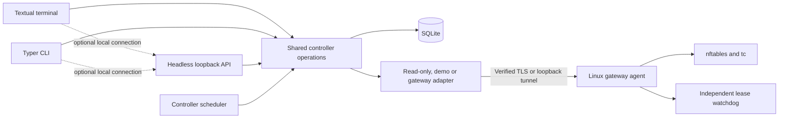

# Architecture

HomeLimiter uses a terminal interface by default. Textual provides keyboard focus,
tables, dialogs and a headless test driver on Windows and Linux. Typer remains the
noninteractive entry point. Both operate on the same Python policy and inventory
services and existing SQLite state.

The controller runtime owns a process lock and the reconciliation loop, separately
from presentation. A local session may run that runtime in its process. Explicit
headless operation keeps it running after a terminal client exits. One runtime owns
each state directory; connected clients use its authenticated loopback JSON API
rather than opening competing writers. The agent is a separate privileged Linux
process. Neither launch path provisions routes, forwarding, or an OS service.

The terminal architecture replaces the browser dashboard so normal startup needs no
HTTP server. Only the headless control and agent
protocols need FastAPI/Uvicorn. The default TUI does not open a listening socket.
The database and policy schema remain compatible with existing state. Restrictions
require explicit target confirmation and serialized reconciliation. The controller
renews the bounded agent lease with fresh inventory and distinguishes saved policies,
active time windows and agent acknowledgements. An acknowledgement is not proof of
traffic coverage. See [the audit](AUDIT.md) and [supported capabilities](SUPPORTED_CAPABILITIES.md).
