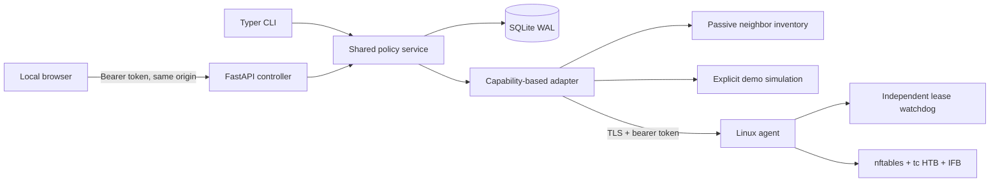

# Architecture

Python 3.12+, FastAPI/Pydantic, parameterized SQLite, Typer, psutil, HTTPX.
Use standard-library SQLite rather than an ORM to keep transaction boundaries visible.
A small bundled dashboard avoids a separate build or runtime on Windows.

Controller desired policies and audit events are durable. A single process owns each
state directory. Serialized reconciliation computes the most restrictive active policy
per device (block wins, minimum rates win). Scheduling uses IANA zones, UTC instants,
half-open windows, and start-day semantics for overnight windows. Reconciliation is
idempotent and runs on restart and periodically. The agent receives a complete desired
snapshot with a short renewable lease. On loss of the controller the agent removes
restrictions after lease expiry; a stopped agent cannot provide that watchdog.

Agent networking is opt-in and Linux-only. It never enables forwarding, constructs a
gateway/bridge, configures NAT, or changes existing firewall policy. The operator must
provision the path. All nft changes are confined to a named table with an ownership
comment. Traffic control requires exclusive, explicitly delegated interfaces and a
dedicated IFB; existing custom root/ingress disciplines cause refusal. Upload shaping
on LAN ingress via IFB precedes SNAT, while download shaping is on LAN egress.
This avoids WAN address classification after NAT. Failure triggers restoration of
the previous owned policy snapshot; failed restoration is reported, never hidden.

There is no claim of hardware-verified enforcement just because commands succeeded.
Agent capability, configured state, installed state, and actual traffic measurements
are distinct. Kernel integration validation is required before use on a real gateway.
