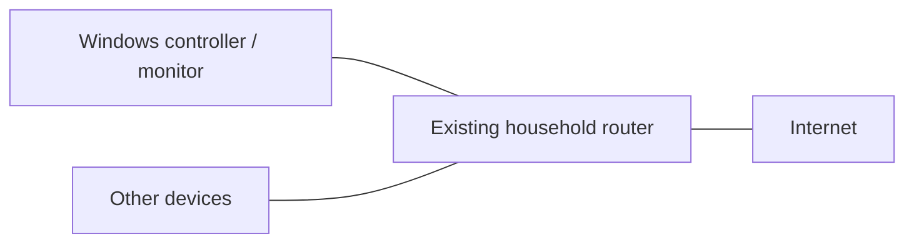
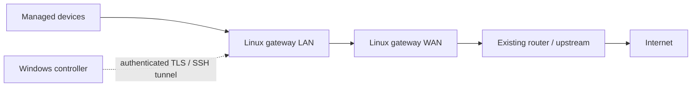
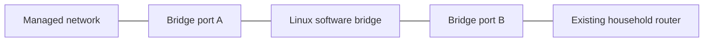
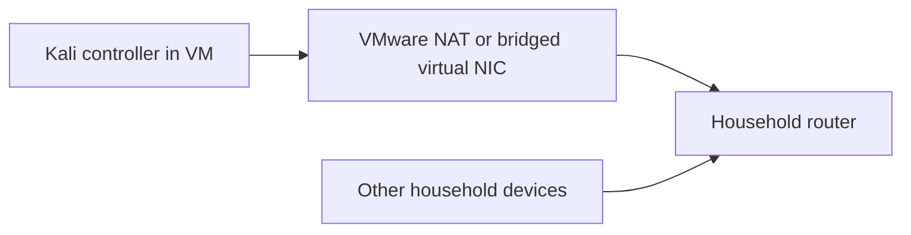

# Network topologies

## Ordinary Windows PC and existing household router

Device traffic does not traverse the PC. Local neighbor information and diagnostics
are possible; arbitrary bandwidth/access enforcement is not. Router brand is irrelevant.

## Authorized routed Linux gateway

The operator explicitly provisions routes, forwarding, exclusions and delegated
interfaces. The existing router can remain upstream; it need not expose a proprietary API.
Both IPv4 and IPv6 must use this path. HomeLimiter manages its own rules only.

## Inline Linux bridge (future enforcement)

A real bridge must be physically inline; a VM merely using bridged mode is different.
The current bridge adapter is monitor-only. Native nft bridge hooks, VLAN filtering,
offload detection and physical-path tests are remaining work.

## Kali in VMware / unsupported environment

Neither VM mode guarantees household traffic crosses Kali. Use it for diagnostics,
development and isolated namespace tests. A deliberately routed VM with two delegated
interfaces is a separate operator-provisioned topology, subject to the gateway checks.
Wi-Fi isolation, shared public networks, unknown networks and alternate unmanaged
paths are unsupported enforcement environments.
